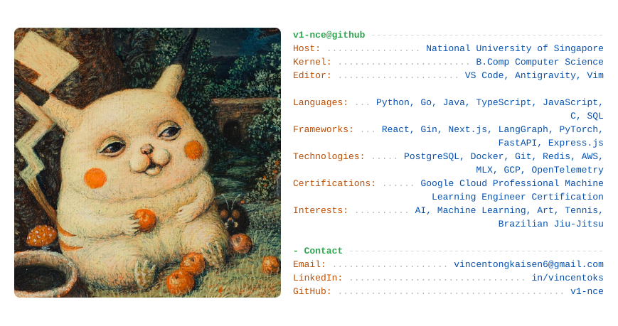
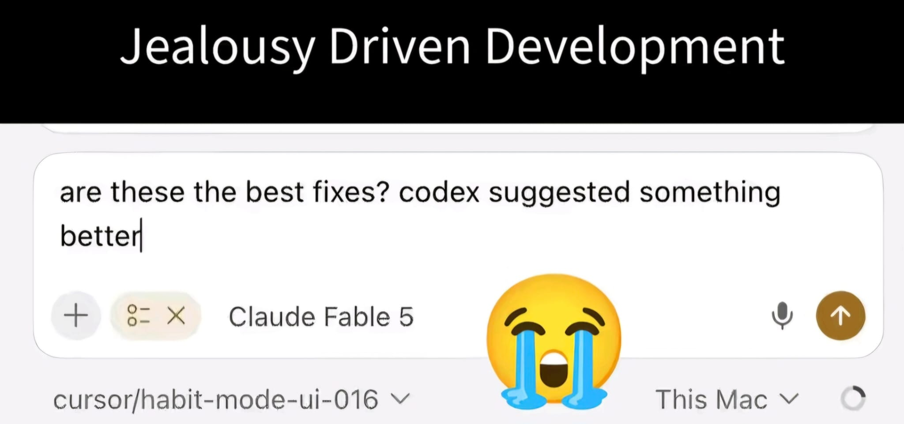

<a href="https://github.com/v1-nce/v1-nce">
  <picture>
    <source media="(prefers-color-scheme: dark)" srcset="https://raw.githubusercontent.com/v1-nce/v1-nce/main/dark_mode.svg">
    
  </picture>
</a>

Hi im Vincent, I love solving problems and creating useful technology! Aside from coding, I like drawing and listening to music :). Anyways, below is an interesting developer meme I came across:

  

